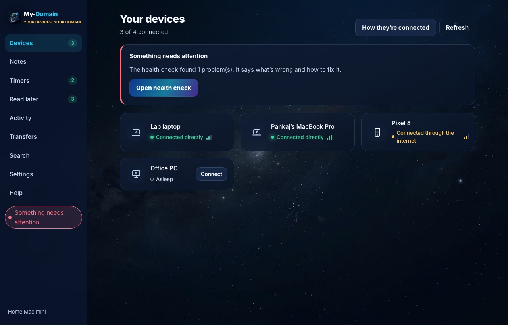
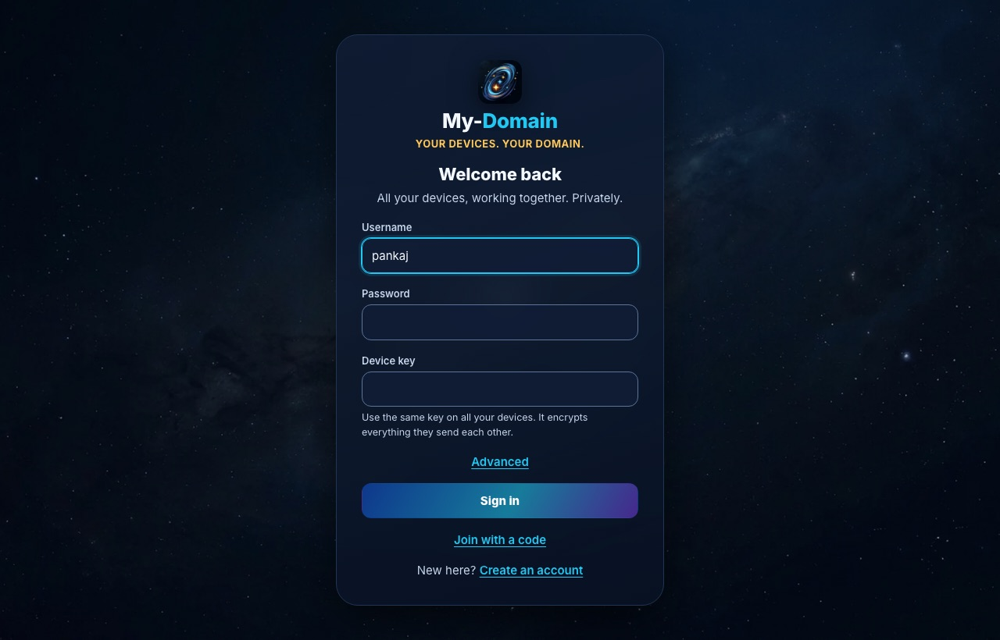
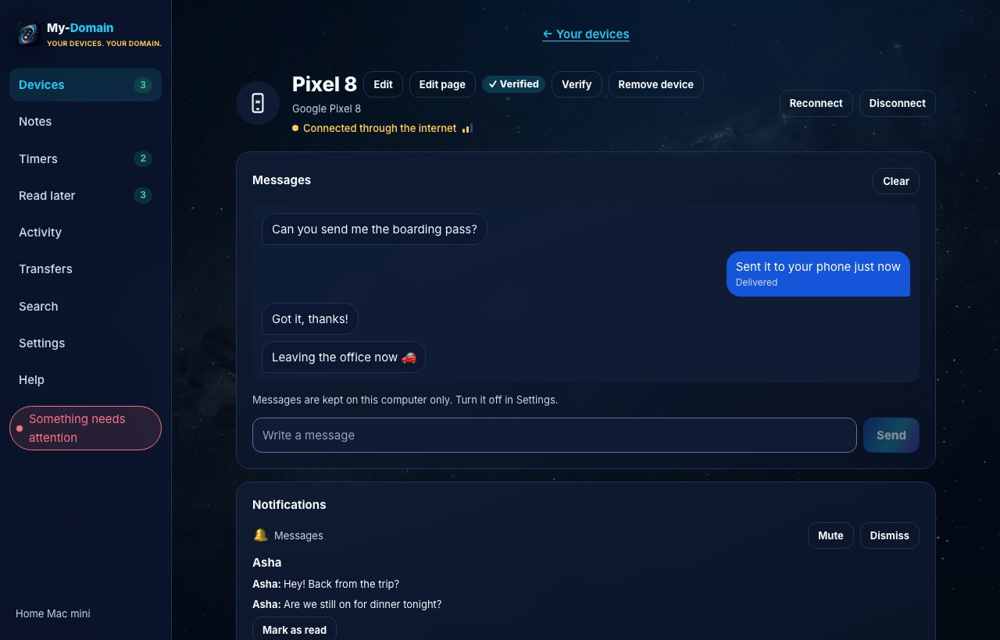
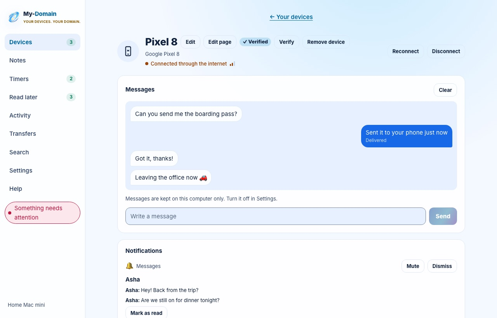
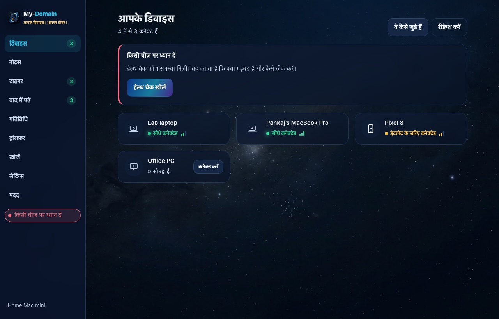
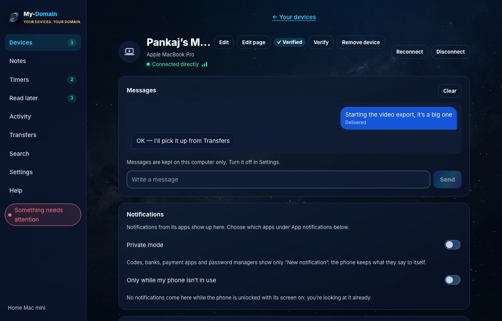
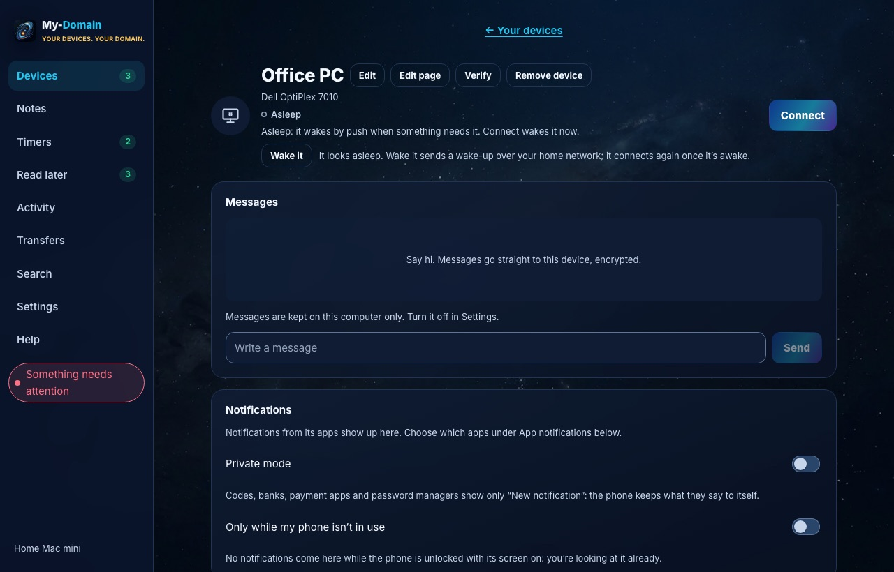
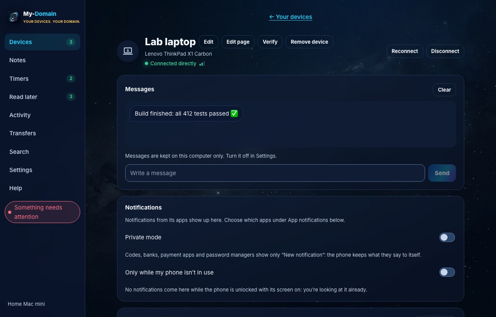
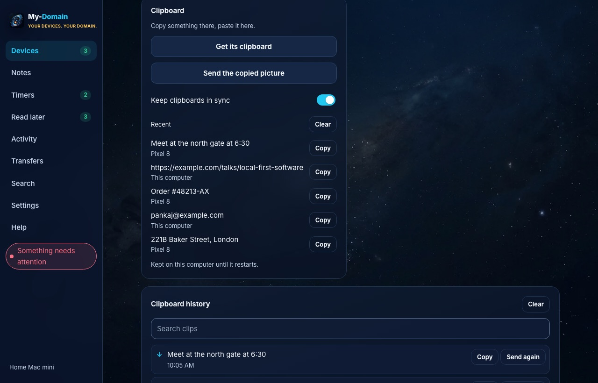

# my-domain at a glance

my-domain links your own phone and computers so they act like one set of devices: messages, clipboard, files, notifications, calls, screens, audio, notes and more move between them over end-to-end encrypted links, directly on the local network where possible and through a relay when not. This page sums up how the apps look and feel (the design language), what is built today, and what is still open or planned. Everything here comes from the code, the docs in `docs/` and the commit messages on the `monorepo` branch. The screenshots are from the desktop app’s screenshot run, made with sample data; see the [Screenshot index](README.md) for the full list.

Android screenshots don’t exist yet. `scripts/screenshots-android.sh` will make them as `screenshots/android/*.png`.

---

## 1. Design language

### The deep-space look

- **The canvas** is a star-field photo (`/space.webp`) under a navy veil that tints it towards the background colour, with one soft radial glow at the top right. The background is fixed, so panels scroll over a still sky. Deep navy is used, never pure black.
- **Glass panels.** The sidebar, sign-in card, device cards, tiles, Activity and empty states are translucent and blur the sky behind them (`backdrop-filter: blur(var(--glass-blur))`, 18 px). Cards have a 1 px hairline border, 18 px corners and no shadow; a clickable card’s border turns cyan on hover.
- **The logo** is the owner’s galaxy image, used as it is (never recoloured, cropped or redrawn). Dark themes show it in a rounded square (22 % corner mask) with a soft drop shadow; Cosmic Light uses a frameless light galaxy with a faint blue shadow.
- **Wordmark:** “My-Domain”, extra-bold, with “Domain” in the accent colour, and the gold tagline “YOUR DEVICES. YOUR DOMAIN.” below it, on sign-in in both apps and in the desktop sidebar. Other copy uses the lowercase name “my-domain”.

Source of truth: the owner’s brand kit (`docs/design/my-domain-brand-theme-kit.html`), written up in `docs/design/theme.md`. The desktop tokens live in `apps/desktop/ui/src/styles/tokens.css`; Android mirrors the same values in `ui/Theme.kt`, so both apps feel like one product. `app.css` has no raw colours: components use tokens only.

### Five themes

Picked in Settings → Appearance ([screenshot](desktop/090-settings-appearance-dark.jpg)), remembered per device, same ids on both apps.

| Theme | id | Character | Canvas |
|---|---|---|---|
| Cosmic Blue (default) | `cosmic-blue` | Dark-first, vivid and trustworthy | Star field, navy veil, blue glow |
| Aurora Purple | `aurora` | Creative, premium, atmospheric | Star field, violet glow |
| Ocean Blue | `ocean` | Calm and connected | Star field, aqua glow |
| Minimal Midnight | `midnight` | Quiet and professional | Flat near-black: no star field, no glow, no blur, flat blue buttons |
| Cosmic Light | `light` | Soft, airy, accessible | Flat cloud white with a faint cyan glow |

### Main colour tokens

| Role | Token | Cosmic Blue (dark) | Cosmic Light |
|---|---|---|---|
| Background | `--bg` | #050B18 | #F4F8FF |
| Panel surface | `--surface` | #0B1630 at 72 % (glass) | #FFFFFF at 86 % |
| Raised surface | `--surface-2` | #101D35 at 86 % | #E7F0FF |
| Opaque panel | `--surface-solid` | #0B1630 | #FFFFFF |
| Border | `--border` | #203454 | #DCE8F7 |
| Control edge (3:1) | `--control-border` | #5D7598 | #73859E |
| Text | `--text` | #F4F8FF | #10213D |
| Secondary text | `--text-2` | #C6D5EA | #33476A |
| Muted text | `--text-3` | #94A3B8 | #56677F |
| Primary | `--primary` | #1455D9 (Royal Blue) | #1769E8 |
| Primary gradient | `--gradient` | “Cosmic Flow”: #1455D9 → #22C7F2 → #713BDB | #1769E8 → #38BDF8 → #713BDB |
| Accent (focus, selection, active nav) | `--accent` | #22C7F2 (Electric Cyan) | #0284C7 |
| Accent as text | `--accent-fg` | #22C7F2 | #0369A1 |
| Highlight (rare moments only) | `--highlight` | #FFC857 (Cosmic Gold) | #F5B942 (text: #8A5900) |
| Success | `--success` | #34D399 | #047857 |
| Warning | `--warning` | #FFC857 | #9A4508 |
| Danger | `--danger` | #FB7185 | #BE123C |

Other themes swap the primary and accent: Aurora #713BDB / #42D9F5 (gold highlight becomes Cosmic Pink #E879F9), Ocean #0759A6 / #00B8D9, Midnight #2563EB / #38BDF8. A thin navy **primary scrim** (`--primary-scrim`) sits over the gradient on primary buttons only, so the white label keeps 4.5:1 at the gradient’s lightest stop.

Kit rules in plain words: cyan is for interaction, gold only for important moments and small accents (never a large fill), green / amber / red mean connected / warning / error, gradients only on primary actions and hero surfaces, never small text on bright cyan or gold.

| Cosmic Blue | Cosmic Light |
|---|---|
|  |  |

### Typography

- **Font:** Inter, bundled in both apps so it works offline (desktop `@fontsource-variable/inter`; Android static TTFs 400–800). Code and ids use `ui-monospace, SFMono-Regular, Menlo, monospace`.
- **Sizes (desktop):** 12, 13, 15, 18, 22 and 26 px (`--text-xs` to `--text-2xl`). Body is 15 px with a 1.55 line height. Page titles are 26 px, extra-bold (800) with slightly tight letter spacing; headings use a 1.25 line height. Android: titles 24 sp / 28 sp line, body 15 sp / 23 sp, 14 sp / 21 sp and 13 sp / 19 sp.
- **Eyebrow labels:** 12 px, weight 800, uppercase, 0.16 em letter spacing, in the accent colour.
- **Indian scripts.** Inter has no Devanagari (Hindi, Marathi), Gujarati or Tamil letters, so the desktop font stack names each system’s face for them right after Inter: Kohinoor and Sangam MN (macOS), Nirmala UI (Windows), Noto Sans and Lohit (Linux). The browser picks per character, so Latin text stays in Inter. Because vowel signs sit above and below the line, `html:lang(hi)`, `lang(mr)`, `lang(gu)` and `lang(ta)` raise the body line height from 1.55 to 1.65. Android’s `Theme.kt` has no script-specific rule.

### Spacing, shape and elevation

- **Spacing:** a 4 px grid: 4, 8, 12, 16, 20, 24, 32, 40 px (`--s-1` to `--s-10`).
- **Corners:** 4 px (bubble tails, signal bars), 10 px (small boxes), 12 px (buttons, inputs, nav items, inner panels), 18 px (cards and tiles), 28 px (the sign-in card), fully round (chips, pills, switches, badges), 22 % (logo mask).
- **Elevation:** panels have no shadow; floating surfaces (sign-in card, toasts, banners) use `0 18px 50px` at about 53 % black; the logo `0 8px 35px`. Status dots glow (12 px; 8 px in Cosmic Light; off in Midnight).
- **Components:** one gradient primary button per view; secondary buttons are a deep panel fill with a hairline; ghost buttons are transparent with a border that turns cyan on hover; inputs sit on the raised surface with the control-edge border.

### Iconography

- **Device icons** (`components/DeviceIcon.tsx`) show the device’s shape (phone, tablet, foldable, laptop, iMac, tower, TV, watch) with a small OS mark inside: an apple for a Mac, four panes for Windows, a penguin for Linux, a robot head for Android. The code says the marks are “simple original glyphs, not the vendors’ logos”. One stroke style (24-unit grid, 1.8 stroke, round caps) in the current text colour, readable at 16–48 px in every theme. There are 17: `android_phone`, `android_tablet`, `android_foldable`, `phone`, `tablet`, `mac_laptop`, `imac`, `mac_desktop`, `win_laptop`, `win_desktop`, `linux_laptop`, `linux_desktop`, `laptop`, `desktop`, `tv`, `watch`, `unknown`. Each device works out its own OS, form, model and maker, and both apps draw the matching icon.
- **Other icons** are simple monochrome glyphs, tinted by role (cyan for interaction, gold for highlights, green for status). No emoji in the UI.

| Mac | Windows | Linux |
|---|---|---|
|  |  |  |

### Motion

- Two durations: `--fast` 120 ms and `--normal` 220 ms, with one easing curve, `cubic-bezier(0.2, 0.8, 0.2, 1)`. Used for hover colours, borders, a small “rise” as panels appear, and a pulsing “Connecting” dot.
- **Reduced motion:** under `prefers-reduced-motion: reduce` both durations become 0, and a global rule at the end of `app.css` stops every animation and transition (including the fixed 1 s pulse, the progress bar and the incoming-call ring). On Android the only animation is the “Connecting” dot, which stays still when the system’s “Remove animations” is on.

### Light and dark

Four themes are dark (`color-scheme: dark`); Cosmic Light is the light companion. The desktop sets `<html data-theme>` before the first render, so the window never flashes the wrong theme, and updates the window chrome colour to match. Most screens in this set have a light twin, e.g. [Home light](desktop/009-home-light.jpg), [Settings light](desktop/065-settings-light.jpg), [Quick panel light](desktop/093-quick-panel-light.jpg).

### Accessibility

Target: **WCAG 2.2 AA** on both apps (`docs/accessibility.md`).

- **Contrast:** every theme’s tokens were measured; text needs 4.5:1, control edges and focus rings 3:1. Fixes included the new `--control-border` (input and switch edges up from about 1.2–1.5:1 to 3.1–3.9:1), the primary scrim (white button labels from 2.0:1 to 4.5:1+), and darker Cosmic Light text, accent and status colours.
- **Focus:** a 2 px solid accent ring, offset 3 px, on every focusable element. A “Skip to content” link is the first Tab stop; changing screens moves focus to the new screen; dialogs keep focus inside and hand it back on close.
- **Screen-reader text:** sidebar badges read as words (“Devices, 2 connected”), two live regions (errors assertive, everything else polite), named screen views (“{name}’s screen, view only”), and a battery graph summed up in words. The `a11y.*` strings exist only for screen readers.
- **Android:** every button is a 48 dp touch target, labels grow with the font size, headings and grouped semantics are marked.
- **Known gaps:** nothing has been run with a real screen reader yet (VoiceOver, NVDA, Orca, TalkBack); Windows High Contrast is untested; contrast was measured over the plain background, not a bright star; tapping a point on the phone’s screen needs a pointer; toasts don’t pause on hover.

### Tone of copy

- Plain words, no jargon: “Connected directly”, “Connected via relay”, not QUIC or RELAY; errors say what to do (“Your phone is offline. Open my-domain on it.”). Technical details live on a hidden Developer screen (tap the version 7 times) ([screenshot](desktop/091-developer-dark.jpg)).
- Short sentences addressed to “you”, typographic apostrophes and quotes (’ “ ”), and limits stated honestly in Help (“The phone’s screen is a picture about twice a second, not smooth video”).
- Permissions are asked when a feature is first used, with a one-line “why”.

### Tiles and page layout

- **Home** is a grid of device cards; a device’s **page** is a grid of tiles, one per feature. Some tiles span the full width (chat, notifications and their history, clipboard history, browse, connection, schedules, photos, apps).
- The tile list is `TILES` in `screens/Device.tsx` (24 tiles): chat, notifications, notification history, clipboard, clipboard history, files, browse, sync, control, info, connection, schedules, commands, screen, camera, insert, now playing, phone audio, computer audio, photos, lost mode, permissions, notify, apps. Some show only on a phone’s page (camera, insert, phone audio, computer audio), and some only when the device offers them right now (e.g. commands when it lists `run`, screen when it lists `screen`).
- **Which layout a page uses:** `phone` or `computer`, worked out from the device’s own status (platform), then its kind, then its icon.
- **“Edit page”** (desktop; “Arrange” or a long-press on the phone) lets you drag a tile by its handle or use Move up / Move down, hide and show tiles, and Reset to default. Changes save as you go. A layout is saved **for all phones or all computers**, or, with “Only for this device”, **for one device**; resetting a device’s own layout sends it back to the shared one. A tile added in a later version appears at its default place, never lost. Each move is announced to screen readers.
- Scrolling captures of the full pages: phone ([720 px](desktop/012-device-phone-00720px-dark.jpg) … [7,200 px](desktop/021-device-phone-07200px-dark.jpg)), [Mac](desktop/024-device-mac-00720px-dark.jpg), [Windows](desktop/032-device-windows-00720px-dark.jpg), [Linux](desktop/039-device-linux-00720px-dark.jpg).

---

## 2. Features done

“Built” means committed on the `monorepo` branch with tests. Many features say “not tried live yet” in `docs/features.md` and the commit notes: they pass tests but haven’t been checked on real devices (see section 3).

### Connection & security

- **Links that find a way:** direct QUIC on the local network (mDNS discovery), hole punching, IPv6, UPnP / NAT-PMP port opening, and a relay over `wss://` as a fallback; the faster route takes over in the background. Devices wake each other by FCM push, with no always-on socket. See the [links map](desktop/044-links-map-dark.jpg).
- **Bluetooth LE** carries small messages with no network at all (first step: phone advertises, computer connects).
- **End-to-end encryption** with replay protection (envelope v2 binds sender, recipient, time and a message id).
- **A key per device**, pinned on first use; each device shows its fingerprint to compare (Settings → [Your security key](desktop/087-settings-key-dark.jpg)). A device whose key changed is refused until you trust it ([dialog](desktop/094-dialog-key-changed-dark.jpg)).
- **Add a device** by QR code or a 6-digit code, valid 5 minutes, single use.
- **Remove a device:** a signed revocation list synced to all your devices ([Removed devices](desktop/068-settings-removed-devices-dark.jpg)).
- **Per-device permissions** for remote input, seeing the screen and sharing mouse & keyboard: off for every device until you allow it ([Settings](desktop/067-settings-permissions-dark.jpg), [prompt](desktop/095-dialog-permission-dark.jpg)).
- **Change passphrase on all devices** (key rotation) ([screenshot](desktop/069-settings-key-rotation-dark.jpg)).
- **Server hardening:** pairing, sign-in, sign-up, relay and push limits; revocable sessions; invite mode. 3 of 3 high and 20 of 22 medium findings of the November security review are fixed.
- **Check connection:** a per-device report of why a link is slow or down, plus a speed test.

### Files & sharing

- **Send files and folders**, as batches with pause, retry and resume after a restart; drop files on a device’s page. All in one [Transfers](desktop/050-transfers-dark.jpg) screen. Folders are capped at 10,000 files.
- **Big files when near:** 20 MB or more moves over Wi-Fi Direct (phone ↔ phone, phone ↔ Windows) or the phone’s hotspot (Mac, Linux), even with no internet. Not on macOS’s Wi-Fi Direct (Apple has no public API).
- **Browse and download** another device’s shared folders; a **Photos** tile of the phone’s recent photos and videos; **photo auto-backup** to the computer on unmetered Wi-Fi.
- **Synced folders,** both ways or one way, conflicts kept as copies, deletions in a 7-day trash ([Settings](desktop/077-settings-sync-dark.jpg)). Phone side lives in Downloads/my-domain/Sync.
- **Send from the file manager:** Finder Services → Send with my-domain (macOS), Send to (Windows), Open with / Dolphin / Nautilus scripts (Linux), from a Settings switch ([screenshot](desktop/076-settings-file-manager-dark.jpg)).
- **Android share sheet** with each device as its own Direct Share target.
- **Download on <device>:** share a link and another device downloads the file itself ([dialog](desktop/097-dialog-download-dark.jpg)).
- **Print from the phone** on a computer’s printer (my-domain is an Android print service). macOS and Linux (CUPS); **not on Windows**, which has no built-in way to print a PDF ([Settings](desktop/082-settings-print-dark.jpg), [prompt](desktop/098-dialog-print-dark.jpg)).
- **Insert from phone** (like Continuity Camera): take a photo or scan documents with the phone into the computer ([Settings](desktop/081-settings-insert-dark.jpg)).

### Clipboard

- **Clipboard sync** (auto or on demand), capped at 256 KB per push, **copied pictures** too.
- **Clipboard history** on both apps, with pictures (newest 50).
- **Privacy:** passwords marked concealed by a password manager stay on the device (macOS and Windows markers; on Linux only through Wayland’s data-control, and not on GNOME); **Excluded apps** by app id (Mac) or program (Windows).
- **Send what you copied** to your phone with a keyboard shortcut.

### Notifications & codes

- **Phone notifications on the computer:** conversations with pictures, reply and buttons from the pop-up, private mode, per-app mute; dismissing on either side clears both.
- **Notification history:** the last 500 kept on disk, searchable, by day.
- **Computer notifications on the phone:** Linux only. Windows not yet (only packaged apps can read notifications); macOS not possible ([Settings](desktop/074-settings-computer-notifs-dark.jpg)).
- **Verification codes:** a one-time code in a phone notification shows on the computer as “Code 482913 from Bank · Copy” (Copy on macOS and Windows; Linux shows a plain notification). Off by default.
- **Quiet when my phone is quiet:** computers hold my-domain’s pop-ups while the phone is on Do Not Disturb.

### Calls & audio

- **Calls on this computer** over Bluetooth hands-free, off by default ([Settings](desktop/073-settings-calls-dark.jpg), [incoming call](desktop/099-dialog-incoming-call-dark.jpg)):
  - **Mac:** answer, decline, hang up, dial, keypad. The call’s sound stays on the phone: macOS refuses call audio to apps (`kIOReturnUnsupported`).
  - **Linux:** controls and sound through the computer’s speaker and microphone.
  - **Windows:** controls only; the sound stays on the phone (Windows gives call audio only to system drivers); no Mute or moving the audio.
- **Phone audio on the computer** (music, video, podcasts; never calls) and **computer sound on the phone**. Mac needs macOS 13+ and can do both directions at once; Linux and Windows one direction at a time. Opus codec, a low-latency nearby mode, and audio over Bluetooth LE at lower quality.
- **Mute here** (mute the device whose sound is playing elsewhere): Mac, Linux and Android; **not offered on Windows** (its capture is after the mute).
- **Now playing and media controls** for other devices: Mac (Spotify and Music), Linux (MPRIS players); **Windows not supported yet**.

### Screen, camera & control

- **Phone screen on the computer**, about two pictures a second; Android asks each time. Tap and swipe it from the computer while the phone shares and allows control.
- **Computer screen on the phone** behind the full-screen touchpad, with Point & click. macOS and Linux (X11 via ImageMagick; Wayland via portals); the code reports Windows as unsupported.
- **Control another computer** from its screen tile (click, right-click, scroll, type).
- **Phone as touchpad and keyboard** for a computer: move, clicks, two-finger scroll, typing, three- and four-finger swipes.
- **Share mouse and keyboard** between your Macs, Windows PCs and Linux computers (like Barrier/Synergy), with a hotkey that always takes control back ([Settings](desktop/080-settings-kvm-dark.jpg)). On Wayland, controlling others needs the input-capture portal (GNOME 45+, KDE Plasma 6+); without it, e.g. on Sway, the computer is **receive only**, and being controlled falls back to `/dev/uinput`.
- **Phone camera on the computer:** live view, front/back, torch, Take photo; about 12 pictures a second (not a video call).
- **Slide remote** from the phone: next, previous, black screen. macOS (needs Accessibility) and Linux (xdotool or wtype); not on Windows yet.

### Phone tools

- **Ring** a device, **Lost mode** (your message over the lock screen), **Find my phone** and **Find my computer** (macOS, Windows location services, Linux GeoClue).
- **Radios from the computer:** Wi-Fi on/off and joining a network, Bluetooth (through the Accessibility helper or Shizuku), Location; airplane mode, mobile data and hotspot open the phone’s settings. **Share this computer’s Wi-Fi** with the phone; join the phone’s hotspot ([dialog](desktop/101-dialog-hotspot-dark.jpg)).
- **Flashlight, ringer mode, volume, brightness / timeout / auto-rotate.**
- **Battery and device info** with a 24-hour battery graph, battery alerts, and the phone’s battery in the menu bar.
- **Wake a sleeping computer** (Wake-on-LAN, same network) and **keep awake** ([Settings](desktop/075-settings-wake-dark.jpg)).
- **Home-screen widgets** (computer status; Notes) and **Quick Settings tiles**; **Set up this phone** checklist of optional permissions.
- **Battery saving** on the phone: background work slows in Battery Saver, at low battery or in doze.

### Productivity

- **Notes:** a shared notepad on all your devices, with reminders (Done / Snooze) and a phone widget ([list](desktop/052-notes-dark.jpg), [open note](desktop/054-notes-open-dark.jpg)). Up to 2,000 notes.
- **Timers** shared between devices; the devices you pick ring at the end ([screenshot](desktop/055-timers-dark.jpg)).
- **Read later:** a list of links, the same on all devices ([screenshot](desktop/057-read-later-dark.jpg)).
- **Activity:** one timeline of what happened between your devices, grouped by day ([screenshot](desktop/048-activity-dark.jpg)).
- **Message history:** chats kept across restarts (newest 2,000 per device).
- **Search** on both apps over devices, messages, clipboard and notification history, files, synced folders, notes, automations, Help and Settings, with filters ([screenshot](desktop/059-search-dark.jpg)). Local to the device it runs on.
- **Command palette** (Cmd+K / Ctrl+K) and a **quick panel** from the menu-bar or tray icon ([screenshot](desktop/092-quick-panel-dark.jpg)).

### Automation & integrations

- **Schedules:** run an action at a time on a device or this computer ([Settings](desktop/083-settings-schedules-dark.jpg)). Runs while the app is open; a time missed asleep is skipped.
- **Automations:** when a device connects, disconnects, runs low or charges, or this computer wakes (desktop); also Wi-Fi joined or left (phone) ([Settings](desktop/084-settings-automations-dark.jpg)).
- **Webhooks:** a local HTTP server on 127.0.0.1 with a bearer token, off by default ([Settings](desktop/085-settings-webhooks-dark.jpg)).
- **Keyboard shortcuts** you bind yourself ([Settings](desktop/072-settings-shortcuts-dark.jpg)).
- **Run command:** commands you write in Settings show as buttons on your other devices ([Settings](desktop/079-settings-commands-dark.jpg)).
- **Browser extension** for Chrome, Edge, Brave, Chromium and Firefox: right-click to send a page, link, selection or image ([Settings](desktop/086-settings-browser-extension-dark.jpg)).
- **Automation apps on the phone:** Tasker, MacroDroid, Automate and others can ask my-domain to run actions.
- **mdctl:** a command-line device with no UI, used for scripted lab scenarios.

### Setup & health

- **First-run setup** in five skippable steps: [name](desktop/003-setup-name-dark.jpg), [devices](desktop/004-setup-devices-dark.jpg), [features](desktop/005-setup-features-dark.jpg), [permissions](desktop/006-setup-permissions-dark.jpg), [connection test](desktop/007-setup-connection-dark.jpg).
- **Health check:** green / grey / amber / red lines, each with one fix ([screen](desktop/046-health-dark.jpg), [Settings](desktop/070-settings-health-dark.jpg)). On macOS it reads the real Bluetooth, Notifications and Local Network permission states; on Wayland it lists each portal and helper.
- **Device labels:** a nickname, icon and colour shared across your devices ([This device](desktop/071-settings-device-dark.jpg)).
- **Back up and restore settings** to a JSON file ([screenshot](desktop/088-settings-backup-dark.jpg)).
- **Automatic updates** for the desktop app, signed downloads only, off by default for auto-install ([screenshot](desktop/089-settings-updates-dark.jpg)).
- **Help** on both apps, short topics written for non-technical users ([Help](desktop/061-help-dark.jpg), [topic](desktop/063-help-topic-dark.jpg)).

### Platforms

- **macOS:** Tauri desktop app; release builds for Apple Silicon and Intel. Some features need Accessibility, Screen Recording or Local Network permission.
- **Windows:** the desktop app builds and is tested in CI. Works: files, clipboard, notifications from the phone, calls (controls only), audio (one direction at a time), Find my computer, share mouse & keyboard, Wi-Fi Direct, remote input. Not offered: printing, Mute here, slide remote, its own screen for others to see, now playing, its notifications on the phone.
- **Linux X11:** everything listed above for Linux; seeing the screen needs ImageMagick, slides need xdotool.
- **Linux Wayland:** through the desktop portals (screen cast, remote desktop, input capture, global shortcuts), each asked once and remembered. Where a portal is missing: grim or still pictures every 2 s for the screen, `/dev/uinput` for being controlled (Sway and other wlroots desktops), receive-only for sharing mouse & keyboard, shortcuts only with an X11 window in front.
- **Android:** Compose app on the shared Rust core (UniFFI). It targets Android 9 on purpose so it can switch Wi-Fi itself; tried on a vivo phone running Android 16.

### Languages

- **English, Hindi (हिन्दी), Marathi (मराठी), Gujarati (ગુજરાતી), Tamil (தமிழ்) and Spanish (Español)** on both apps. Desktop: all 2,172 strings, follows the system language with a choice in Settings. Android: all 1,732 strings, plus Android 13+’s per-app language page. A missing translation shows in English, and `scripts/check-translations.py` checks keys and placeholders.
- [Phone page in Hindi](desktop/103-device-phone-hindi-dark.jpg).
- Help topics stay in English.

---

## 3. Upcoming / not yet done

### a. Gaps / open items

| Item | Status |
|---|---|
| **Real-device testing.** Many features pass tests but are marked “not tried live yet” (e.g. synced folders, lost mode on a phone, webhooks, automations, schedules, battery graph). No screen reader or TalkBack run yet. | Planned |
| **Mac call audio** through a USB Bluetooth adapter with BTstack, since macOS refuses call audio to apps | On hold |
| **Account security UI** (change account password, sign out all devices, signed-in sessions): landed on `monorepo` (e972ee8) while these pictures were made; the desktop part shows in [Settings → Account](desktop/066-settings-account-dark.jpg). Still to try on real devices | Done, untested live |
| **Dates and numbers in the chosen language** | Planned |
| **Help pages translated** (they stay English today) | Planned |
| **Android Settings search for Removed devices** | Planned |
| **Updater signing key:** the app ships a placeholder public key, so update checks are off until the owner sets the key and the release secrets | Needs the user |
| **Security review M5:** the 6-digit pairing code’s box can be opened offline (only 10^6 codes). Suggested: heavier Argon2 or a PAKE; QR pairing is the stronger option | Planned |
| **Security review M15:** no free-space check before accepting a file, so a compromised device could fill the disk | Planned |
| **Security review, low items still open:** per-device limits on Run command (L3), restored backups bring commands and automations back enabled (L4), hotspot password visible in process arguments (L5), the extension sends cookies on fetch (L6), received files carry no quarantine mark (L11), Windows reserved and bidi names in received files (L12), a 2-way synced peer can trash a whole folder, recoverable for 7 days (L16), and others (L8–L10, L13–L15, L17, L19, L20) | Planned |
| **Rotate the server `JWT_SECRET`, archive the six old GitHub repos, fix the laptop’s dirty NTFS partition** (`docs/PENDING.md`) | Needs the user |
| **Office networks block the free server names** (FortiGuard blocks dynamic-DNS domains); a paid domain would pass | Needs the user |
| **Connectivity leftovers:** relays in more than one region, a QUIC relay, choosing between two live paths by quality, an opt-in “Stay connected with the screen off” | Planned |
| **Bluetooth LE leftovers:** the desktop app starting `md-ble`, phone-to-phone | Planned |
| **Domains and sharing with other people** (domains, grants, presets, audit log, “Revoke all”) from `docs/features.md` | Planned |
| **Android features not started:** SMS read/send, contacts, calendar, answer/end calls from the computer, remote wipe, screen recording, single-app mirror | Planned |
| **Accessibility gaps:** Windows High Contrast, keyboard taps on a phone’s screen, announcing new chat messages on Android | Planned |
| **Android battery audit:** 47 findings, 24 fixed (`docs/ANDROID-BATTERY-AUDIT-2026-11.md`) | Planned |
| **More devices:** Android TV, Wear OS | Planned |
| **iOS** | Not planned |

`docs/PENDING.md` is dated 2026-11-02 and some of its items are done since (QR pairing, Windows desktop code); the table keeps only what is still open.

### b. Planned features

All user-approved, status **Planned**.

1. **Right-click “Send to <device>” in Finder / Explorer / Nautilus-Dolphin** (macOS Quick Action/Services, Windows Explorer context menu, Linux file-manager actions). Effort: **small**.
   - *Exists today:* one generic entry that opens my-domain’s own device picker: Finder **Services → Send with my-domain** (macOS lists it by itself), **Send to → my-domain** shortcut on Windows, and **Open with**, Dolphin and Nautilus (Files’ Scripts menu) entries on Linux, the last two added or removed by a Settings switch (`FileManagerSetting.tsx`, `send_to.rs`).
   - *Planned:* an entry per device (“Send to Pixel 8”) straight from the menu, a macOS Quick Action, and a real Explorer context-menu item.
2. **Phone screenshots (and optionally new photos) appear on the computer automatically,** copied to the clipboard and saved. Effort: **small**.
   - *Exists today:* photo auto-backup to the computer, copied pictures between clipboards, and the Photos tile. Nothing watches for new screenshots.
3. **Phone as the computer’s webcam and microphone** (virtual camera: macOS CoreMediaIO camera extension (needs Apple signing), Windows 11 virtual camera API, Linux v4l2loopback). Effort: **large**.
   - *Exists today:* the Phone camera tile shows the camera inside my-domain only (about 12 pictures a second), and phone audio on the computer carries media, never the microphone.
4. **Click a phone number on the computer → call from the phone** (`tel:` handler on desktop, phone dialer, no call-log permission). Effort: **small**.
   - *Exists today:* “Dial from the computer” opens the phone’s dialer with a number (you press Call), and Calls on this computer can dial. No `tel:` link handler is registered on the desktop.
5. **Send to a friend’s nearby device** (AirDrop/Quick Share-like for other accounts, approve each transfer). Effort: **medium**.
   - *Exists today:* sending works only between devices on your own account; the Wi-Fi Direct / hotspot path for big files could carry it.
6. **Search across all your devices** (files, notes, clipboard, messages). Effort: **medium**.
   - *Exists today:* Search on each app covers that device’s own data, including the histories it keeps of other devices; it doesn’t ask other devices.
7. **Phone as a presentation remote** (next/prev, laser pointer, timer, speaker notes). Effort: **small**.
   - *Exists today:* a `slides` action on desktops with next, previous and black screen from the phone (macOS with Accessibility, Linux with xdotool or wtype; Windows says it isn’t supported yet). No laser pointer, timer or speaker notes.
8. **Tablet/phone as a second screen** (extend the desktop; hard on macOS). Effort: **large**.
   - *Exists today:* the computer’s screen can be viewed on the phone (about two pictures a second) behind the touchpad; nothing extends the desktop.
